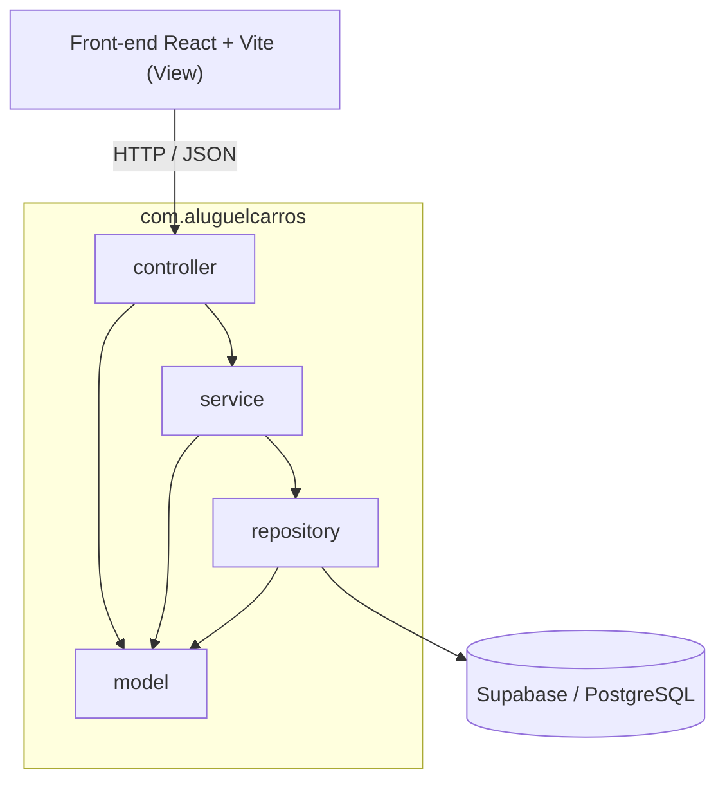
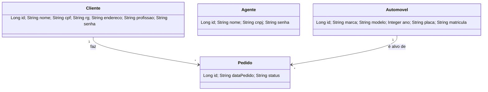
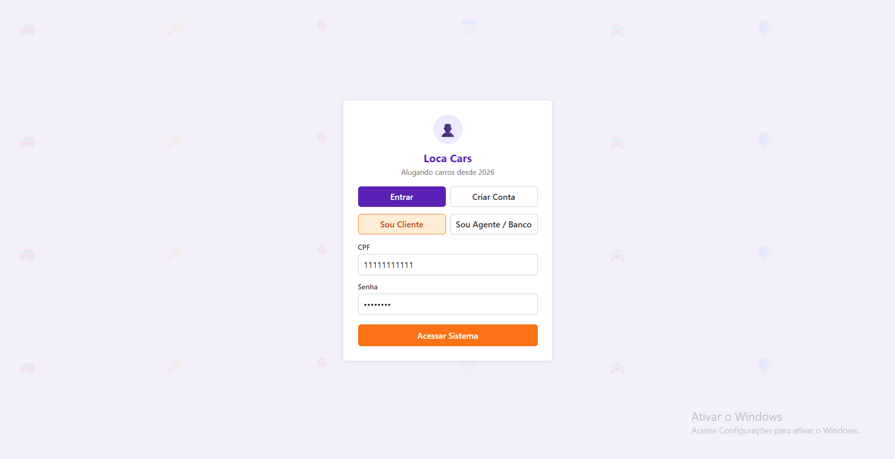
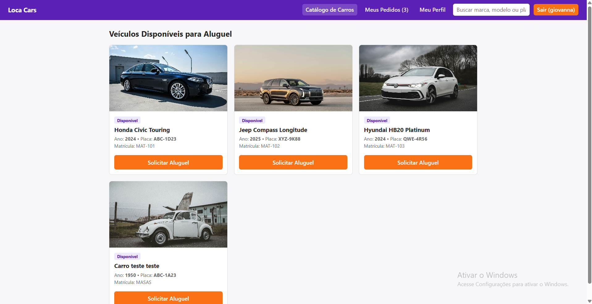
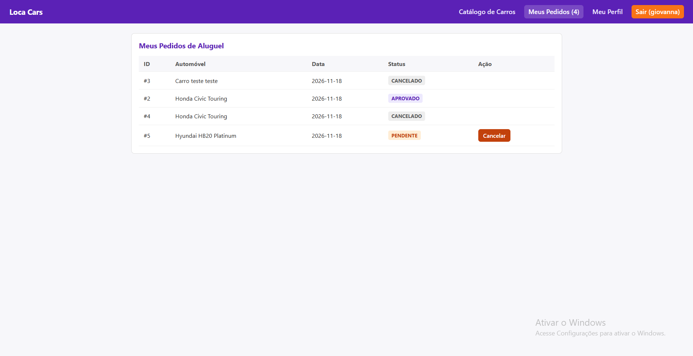
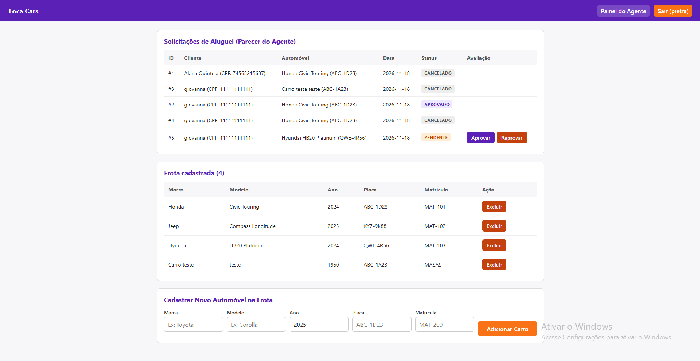

# 🚘 LocaCars: Mini Sistema de Aluguel de Carros (estudo)

---

## 🚧 Status do Projeto

     

---

## 📚 Índice
- [Sobre o Projeto](#-sobre-o-projeto)
- [Funcionalidades Principais](#-funcionalidades-principais)
- [Limitações Conhecidas](#-limitações-conhecidas)
- [Tecnologias Utilizadas](#-tecnologias-utilizadas)
- [Arquitetura](#-arquitetura)
- [Instalação e Execução](#-instalação-e-execução)
- [Estrutura de Pastas](#-estrutura-de-pastas)
- [API (Endpoints)](#-api-endpoints)
- [Demonstração](#-demonstração)
- [Testes](#-testes)
- [Documentações utilizadas](#-documentações-utilizadas)
- [Autores](#-autores)
- [Licença](#-licença)

---

## 📝 Sobre o Projeto

O **LocaCars** simula o sistema de uma locadora que permite **efetuar, cancelar e consultar pedidos de aluguel de automóveis pela internet**. Ele foi desenvolvido como Laboratório 02 da disciplina de Desenvolvimento e Integração de Aplicações Web.

- **Problema que resolve:** centraliza em um só lugar o pedido do cliente e a avaliação do agente (empresa ou banco).
- **Contexto:** acadêmico, seguindo o enunciado do Lab 02.
- **Quem usa:** *clientes* (pessoa física, entram com CPF) e *agentes* (empresas e bancos, entram com CNPJ).

O sistema só pode ser usado após **cadastro e login**.

---

## ✨ Funcionalidades Principais

**Cliente**
- 🔐 **Cadastro e login** com CPF e senha.
- 🚗 **Catálogo de carros** com foto, ano, placa e matrícula, e **busca** por marca, modelo ou placa.
- 📝 **Solicitar aluguel** de um carro (o pedido nasce como `PENDENTE`).
- 📋 **Meus pedidos:** consulta do status (`PENDENTE`, `APROVADO`, `REPROVADO`, `CANCELADO`) e **cancelamento** de pedidos pendentes.
- 👤 **Meu perfil:** consultar, **editar** e **excluir** a própria conta (CRUD de cliente).

**Agente (empresa ou banco)**
- 🔐 Cadastro e login com CNPJ e senha.
- ✅ **Avaliar pedidos:** aprovar ou reprovar pedidos pendentes.
- 🚘 **Frota:** cadastrar e excluir automóveis.

**Geral**
- 📱 Interface responsiva (menu sanduíche no celular).
- ✔️ Validações: CPF (11 números), CNPJ (14 números), placa e ano do carro.

---

## ⚠️ Limitações Conhecidas

Itens do enunciado ou de boas práticas que **ficaram como próximos passos**:

- ✏️ **Modificar um pedido** já criado (hoje só é possível cancelar e fazer um novo pedido).
- 👷 **Empregadores e rendimentos do contratante (máximo 3).**
- 🚗 **Propriedade do automóvel** (cliente, empresa ou banco).
- 🔒 **Senhas são guardadas em texto puro** e a API devolve o campo `senha`. O ideal seria criptografar (BCrypt) e esconder o campo.
- 🪪 A validação do CPF e do CNPJ confere só o **formato**, não os dígitos verificadores, e o CPF não é único no banco.
- 🏦 **Contrato de aluguel e contrato de crédito** (banco agente): não implementados nesta versão.
- 🧱 Excluir um carro que já tem pedidos é recusado. Excluir um cliente apaga também os pedidos dele.
- 🧩 O front-end está em um único arquivo (`App.jsx`); o próximo passo do meu estudo vai ser separar em `pages` e `components`.

---

## 🛠 Tecnologias Utilizadas

### 💻 Front-end
- **React** + **Vite** (JavaScript/JSX)
- **CSS** puro (`App.css`, `index.css`)
- Navegação por abas controladas por estado (`useState`), sem React Router
- Comunicação com a API via `fetch`

### ⚙️ Back-end
- **Java 25**
- **Spring Boot 4.0.9** (Spring Web MVC, Spring Data JPA)
- **Apache Maven** (Maven Wrapper, não precisa instalar)
- **Hibernate** (`ddl-auto=update` cria as tabelas)
- Bean Validation (`spring-boot-starter-validation`)

### 🗄️ Banco de dados
- **Supabase (PostgreSQL)**, acessado via **Session pooler** (para funcionar em redes IPv4)

---

## 🏗 Arquitetura

O back-end segue o padrão **MVC em camadas**; o **React** faz o papel da *View*.



| Camada | Papel |
|---|---|
| **controller** | Recebe as requisições HTTP e devolve JSON |
| **service** | Regras de negócio |
| **repository** | Acesso ao banco (Spring Data JPA) |
| **model** | Entidades (`Cliente`, `Agente`, `Automovel`, `Pedido`) |

### Diagrama de classes (resumo)



---

## 🚀 Instalação e Execução

### Pré-requisitos

| Ferramenta | Versão | Conferir com |
|---|---|---|
| JDK | 25 | `java -version` |
| Node.js | 20.19+ (testado com 24) | `node -v` |
| Git | qualquer | `git --version` |
| Conta no Supabase | com um projeto criado | |

O **Maven não precisa ser instalado** (usa-se o `mvnw`). Na primeira execução é necessária internet para baixar as dependências.

### 🔐 Variáveis de Ambiente

As credenciais do banco **não ficam no código**. O `application.properties` lê três variáveis:

```properties
spring.datasource.url=${DB_URL}
spring.datasource.username=${DB_USER}
spring.datasource.password=${DB_PASSWORD}
```

| Variável | Exemplo | Onde achar |
|---|---|---|
| `DB_URL` | `jdbc:postgresql://aws-0-xxx.pooler.supabase.com:5432/postgres` | Supabase → **Connect → Session pooler** (só o host, com o prefixo `jdbc:postgresql://`) |
| `DB_USER` | `postgres.abcdefghij` | Supabase → Session pooler (usuário `postgres.<ref-do-projeto>`) |
| `DB_PASSWORD` | `sua-senha` | Senha do banco definida ao criar o projeto |

> [!IMPORTANT]
> Use a conexão **Session pooler**. A conexão direta do Supabase usa IPv6 e falha em muitas redes.

### 1. Clonar o repositório

```bash
git clone <URL-DO-REPOSITORIO>
cd mini_sistema_aluguel_de_carros
```

### 2. Criar o arquivo `.env` (back-end)

Dentro de `backend/aluguel-carros`, crie o `.env` **a partir do terminal** (evita erro de extensão `.txt` ou de codificação do Bloco de Notas). Troque pelos seus valores, **sem aspas, sem espaços e sem `<` `>`**:

**Windows (PowerShell):**
```powershell
cd backend\aluguel-carros
@"
DB_URL=jdbc:postgresql://SEU-HOST:5432/postgres
DB_USER=postgres.SEU-REF
DB_PASSWORD=SUA-SENHA
"@ | Set-Content -Path .env -Encoding ascii
```

O `.env` está no `.gitignore` e **não deve ser enviado ao GitHub**. O arquivo `.env.example` mostra o formato.

Confira se não restou texto de exemplo (deve imprimir `0`):
```powershell
(Select-String -Path .env -Pattern "<").Count
```

### 3. Rodar o back-end (Terminal 1)

Continue no mesmo terminal do passo 2.

**Windows (PowerShell):**
```powershell
powershell -ExecutionPolicy Bypass -File .\rodar-backend.ps1
```

O script lê o `.env`, cria as variáveis só para aquele terminal e executa `mvnw spring-boot:run`.

**Alternativa sem o script** (também no PowerShell):
```powershell
$env:DB_URL="jdbc:postgresql://SEU-HOST:5432/postgres"
$env:DB_USER="postgres.SEU-REF"
$env:DB_PASSWORD="SUA-SENHA"
.\mvnw.cmd spring-boot:run
```

**Linux / macOS:**
```bash
cd backend/aluguel-carros
export DB_URL="jdbc:postgresql://SEU-HOST:5432/postgres"
export DB_USER="postgres.SEU-REF"
export DB_PASSWORD="SUA-SENHA"
./mvnw spring-boot:run
```

Aguarde a mensagem **`Started AluguelCarrosApplication`**. O back-end fica em `http://localhost:8080`. As tabelas são criadas automaticamente no Supabase (`ddl-auto=update`).

### 4. Rodar o front-end (Terminal 2)
Abra um segundo terminal na raiz do repositório

```bash
cd frontend
npm install
npm run dev
```

Abra **http://localhost:5173**.


### 5. Primeiro uso

1. Em **Criar Conta**, cadastre um **agente** (CNPJ com 14 números) e um **cliente** (CPF com 11 números), ambos só com números.
2. Como cliente, se o catálogo estiver vazio, clique em **"+ Carregar 3 Carros de Exemplo"** (ou cadastre carros pelo painel do agente).
3. Faça um pedido, troque para a conta do agente e aprove ou reprove.

### 🧯 Problemas comuns

| Sintoma no terminal | Causa provável | Solução |
|---|---|---|
| `UnknownHostException: <host...>` | `.env` com os valores de exemplo ou sem salvar | Refazer o passo 2 e conferir o `Count` |
| `Failed to determine a suitable driver class` / `url attribute is not specified` | Variáveis não chegaram ao Spring | Rodar pelo `rodar-backend.ps1` ou definir as variáveis no mesmo terminal |
| Erro de conexão / *timeout* | Rede bloqueando a porta do banco | Usar o Session pooler ou outra rede (ex.: hotspot do celular) |
| `password authentication failed` | Usuário ou senha incorretos | Conferir `DB_USER` (`postgres.<ref>`) e a senha |
| Projeto Supabase pausado | Plano gratuito inativo | **Restore project** no painel |
| `npm` não reconhecido | Node.js não instalado | Instalar o Node.js |
| Front sem dados / alerta de conexão | Back-end fora do ar | Conferir o Terminal 1 |
| `'url' must start with "jdbc"` | Rodou o `mvnw` direto, sem carregar o `.env` | Rodar pelo `rodar-backend.ps1` ou definir as variáveis no mesmo terminal |

---

## 📁 Estrutura de Pastas

```
mini_sistema_aluguel_de_carros/
├── README.md
├── .gitignore
├── docs/                       ← diagramas UML e histórias de usuário
├── backend/
│   └── aluguel-carros/
│       ├── .env.example        ← modelo das variáveis (sem segredos)
│       ├── rodar-backend.ps1   ← carrega o .env e sobe o back-end
│       ├── pom.xml
│       ├── mvnw / mvnw.cmd
│       └── src/main/
│           ├── java/com/aluguelcarros/
│           │   ├── AluguelCarrosApplication.java
│           │   ├── controller/   ← Cliente, Agente, Automovel, Pedido
│           │   ├── service/
│           │   ├── repository/
│           │   └── model/
│           └── resources/application.properties
└── frontend/
    ├── package.json
    ├── index.html
    ├── public/carros/          ← fotos do catálogo
    └── src/
        ├── main.jsx
        ├── App.jsx             ← telas e chamadas à API
        ├── App.css
        └── index.css
```

---

## 🔌 API (Endpoints)

Base: `http://localhost:8080`

| Método | Rota | Função |
|---|---|---|
| `POST` | `/clientes` | Cadastrar cliente |
| `POST` | `/clientes/login` | Login do cliente (CPF e senha) |
| `GET` | `/clientes` | Listar clientes |
| `PUT` | `/clientes/{id}` | Editar dados do cliente |
| `DELETE` | `/clientes/{id}` | Excluir cliente |
| `POST` | `/agentes` | Cadastrar agente |
| `POST` | `/agentes/login` | Login do agente (CNPJ e senha) |
| `GET` | `/automoveis` | Listar carros |
| `POST` | `/automoveis` | Cadastrar carro |
| `DELETE` | `/automoveis/{id}` | Excluir carro |
| `GET` | `/pedidos` | Listar pedidos |
| `POST` | `/pedidos` | Criar pedido |
| `PUT` | `/pedidos/{id}/status` | Alterar status (aprovar, reprovar, cancelar) |

---

## 🖼️ Demonstração

| Login | Catálogo |
|:--:|:--:|
|  |  |

| Meus pedidos | Painel do agente |
|:--:|:--:|
|  |  |

---

## 🧪 Testes

Testes manuais realizados:

| # | Teste | Esperado |
|---|---|---|
| 1 | Cadastrar cliente com CPF de 11 números | Entra no sistema |
| 2 | Cadastrar com CPF de 10 números | O navegador recusa |
| 3 | Login com senha errada | Alerta de credenciais |
| 4 | Buscar "civic" e depois "xyz" | Mostra o carro / "Não temos esse veículo" |
| 5 | Solicitar aluguel | Pedido `PENDENTE` em Meus Pedidos |
| 6 | Cancelar o pedido | Status `CANCELADO` |
| 7 | Entrar como agente | Aprovar/Reprovar só em pedidos pendentes |
| 8 | Aprovar e voltar à conta do cliente | O cliente vê `APROVADO` |
| 9 | Cadastrar carro com placa inválida | Recusado |
| 10 | Excluir carro sem pedidos / com pedidos | Some / mensagem de pedidos vinculados |
| 11 | Editar profissão no perfil e entrar de novo | Alteração salva |
| 12 | Desligar o back-end e tentar entrar | Mensagem de falha de conexão |
| 13 | Excluir a conta de um cliente que tem pedidos | Conta e pedidos somem; o agente não vê mais esses pedidos |

---

## 🔗 Documentações utilizadas

* 📖 [React](https://react.dev/learn)
* 📖 [Vite](https://vite.dev/guide/)
* 📖 [Spring Boot](https://docs.spring.io/spring-boot/index.html)
* 📖 [Supabase: conectar ao banco](https://supabase.com/docs/guides/database/connecting-to-postgres)
* 📖 [MDN: Fetch API](https://developer.mozilla.org/pt-BR/docs/Web/API/Fetch_API)
* 📖 [Conventional Commits](https://www.conventionalcommits.org/pt-br/v1.0.0/)

---

## 👥 Autora


| 👤 Nome | :octocat: GitHub |
|---|---|
| **Isadora** | [github.com/isadoraalvarenga](https://github.com/isadoraalvarenga) |

---

## 📄 Licença

Projeto acadêmico distribuído sob a **Licença MIT**.